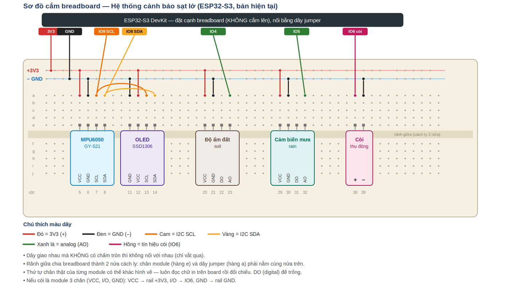

# ESP32-Based Landslide Early Warning System

ESP32-S3 early-warning device for landslide-prone slopes. It combines an accelerometer (MPU6050) to detect abnormal ground tilt with a soil moisture sensor and a rain sensor. When all three readings exceed their thresholds at the same time, the device sounds a buzzer, shows a warning on an OLED display, and sends a push notification to a phone through Blynk IoT.

Final project for a Microcontroller course (team project).

## Features

- Tilt measured as the angle between the current gravity vector and the gravity vector recorded at installation (0–90°), with sample averaging and the MPU6050's built-in low-pass filter to reduce noise
- Soil moisture and rain intensity read as analog values and converted to %
- Local display on a 128x64 SSD1306 OLED and an audible buzzer alarm
- Real-time monitoring on the Blynk mobile app (updates every 2 s)
- Push notification on alert, sent once when the state changes from safe to danger, with a 10-minute cooldown

## Hardware

| Component | Interface | ESP32-S3 pin |
|---|---|---|
| MPU6050 (GY-521) | I2C | SDA = GPIO8, SCL = GPIO9 |
| SSD1306 OLED 0.96" | I2C (shared bus) | SDA = GPIO8, SCL = GPIO9 |
| Soil moisture sensor (AO) | Analog | GPIO4 (ADC1) |
| Rain sensor (AO) | Analog | GPIO5 (ADC1) |
| Passive buzzer | Digital (tone) | GPIO6 |

All modules are powered from 3.3 V. Analog inputs use ADC1 pins because ADC2 cannot be used while Wi-Fi is active.

## Alert logic

An alert is triggered only when all three conditions are true:

| Condition | Threshold |
|---|---|
| Tilt from installation angle | ≥ 10° |
| Soil moisture | ≥ 60 % |
| Rain intensity | ≥ 50 % |

Thresholds were chosen by the team and should be calibrated experimentally. The raw-to-percent mapping (`map(raw, 4095, 1200, 0, 100)`) must also be calibrated for the actual sensors.

## Blynk setup

Datastreams (Virtual Pins):

| Pin | Name | Type | Range |
|---|---|---|---|
| V0 | Tilt | Double | 0–90 |
| V1 | Soil moisture | Integer | 0–100 |
| V2 | Rain | Integer | 0–100 |
| V3 | Alert | Integer | 0–1 |

Event code: `canh_bao_sat_lo` (push notification enabled).

## Build and run

1. Open the project in VS Code with the PlatformIO extension.
2. Copy `include/secrets_example.h` to `include/secrets.h` and fill in your Blynk Template ID, Template Name, Auth Token and Wi-Fi (2.4 GHz) credentials. `secrets.h` is ignored by git.
3. Build and upload. Keep the sensor pole still during start-up so the baseline angle can be recorded.

## Team

- (add team members here)
